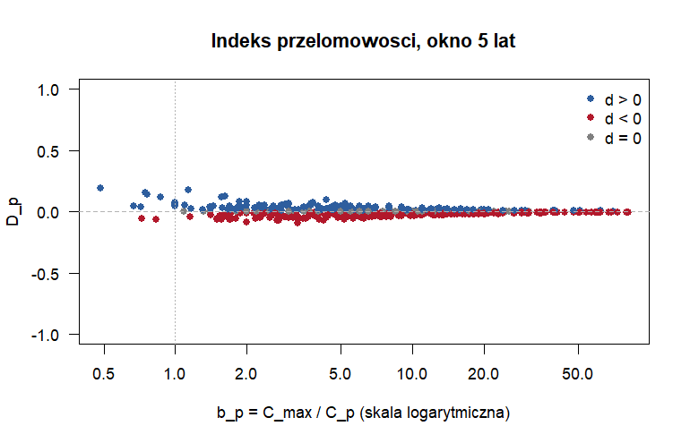

<!-- README.md powstaje z README.Rmd. Zmiany wprowadza się w README.Rmd,
a następnie renderuje plik poleceniem devtools::build_readme(). -->

# WyparcieR

[](https://github.com/mendelowska-karolina/wyparcie-r/actions/workflows/R-CMD-check.yaml)

Pakiet języka R do analizy przełomowości publikacji naukowych. Pakiet
wyznacza klasyczny indeks przełomowości $D_p$ wraz ze składowymi
opisanymi przez Lin, Li i Wu (2026): licznościami trzech kategorii prac
cytujących, bilansem bezpośrednio cytujących $d_p$, stosunkiem $R_k$
oraz czynnikiem $b_p$ związanym z najczęściej cytowanym źródłem
publikacji. Składowe pokazują, czy wartość indeksu wynika z cytowań
samej publikacji, czy z popularności jej źródeł.

Projekt dyplomowy na kierunku elektroniczne przetwarzanie informacji,
Instytut Studiów Informacyjnych Uniwersytetu Jagiellońskiego. Tytuł
pracy: *Pakiet R do analizy przełomowości publikacji jako przykład
zastosowania operacji na macierzach rzadkich w badaniach nad tożsamością
płciową i seksualnością*. Promotor: dr Marek Deja.

## Problem badawczy

Indeks przełomowości opisuje, czy późniejsze prace cytują publikację bez
jej źródeł, czy razem z nimi. Publikacja cytowana bez swoich źródeł bywa
odczytywana jako praca, która wyparła wcześniejszą linię badań. Jedna
liczba łączy jednak dwa różne zjawiska: bilans cytowań publikacji oraz
liczbę prac, które cytują wyłącznie jej źródła.

Lin, Li i Wu (2026) pokazują, że indeks $D_p$ zależy silnie od relacji
między cytowaniami publikacji a cytowaniami jej najczęściej cytowanego
źródła. Popularne źródło zwiększa mianownik indeksu i ściąga jego
wartość do zera także przy wyraźnym bilansie bezpośrednio cytujących.
Badacz porównujący publikacje potrzebuje więc wartości indeksu razem z
jego składowymi.

Pakiet udostępnia wszystkie składowe w jednym rachunku, raportuje zerowe
mianowniki i niekompletność sieci cytowań oraz pozwala porównać okna
cytowań. Zamierzonym obszarem zastosowania są publikacje z badań nad
tożsamością płciową i seksualnością. Wynik opisuje wzorzec cytowań
zarejestrowany w bazie danych; ocena nowości treści wymaga odrębnych
dowodów.

## Metoda

Sieć cytowań jest grafem skierowanym: krawędź `cytujacy -> cytowany`
oznacza odwołanie. Dla publikacji $p$ z rokiem $y$ i okna o długości $w$
lat zbiór $F$ obejmuje prace cytujące $p$, a zbiór $B$ prace cytujące co
najmniej jedno źródło $p$. Oba zbiory dotyczą prac opublikowanych w
latach od $y + 1$ do $y + w$.

**Liczności kategorii.** Prace cytujące dzielą się na trzy rozłączne
kategorie:

$$
N_i = |F \setminus B|, \qquad N_j = |F \cap B|, \qquad
N_k = |B \setminus F|.
$$

$N_i$ liczy prace cytujące publikację bez jej źródeł, $N_j$ prace
cytujące publikację razem z co najmniej jednym źródłem, a $N_k$ prace
cytujące tylko źródła. Praca cytująca kilka źródeł należy do $B$ jeden
raz.

**Indeks przełomowości.** Klasyczny indeks (Funk i Owen-Smith, 2017)
wynosi

$$
D_p = \frac{N_i - N_j}{N_i + N_j + N_k}.
$$

Indeks przyjmuje wartości od $-1$ do $1$. Wartość dodatnia oznacza
przewagę prac cytujących publikację bez źródeł, wartość ujemna przewagę
współcytowania publikacji ze źródłami.

**Bilans i stosunek.** Dwie składowe rozdzielają licznik i mianownik
indeksu:

$$
d_p = \frac{N_i - N_j}{N_i + N_j}, \qquad R_k = \frac{N_k}{N_i + N_j}.
$$

Bilans $d_p$ opisuje wyłącznie prace cytujące publikację. Stosunek $R_k$
porównuje liczbę prac cytujących tylko źródła z liczbą cytowań
publikacji $C_p = N_i + N_j$. Przy dodatnich mianownikach zachodzi
dokładna tożsamość

$$
D_p = \frac{d_p}{1 + R_k},
$$

z której wynika, że przy dużym $R_k$ indeks $D_p$ jest bliski zeru
niezależnie od bilansu $d_p$.

**Najczęściej cytowane źródło.** Niech $C_{\max}$ oznacza największą
liczbę cytowań pojedynczego źródła $p$ w tym samym oknie. Czynnik

$$
b_p = \frac{C_{\max}}{C_p}
$$

porównuje popularność najczęściej cytowanego źródła z popularnością
publikacji. Lin, Li i Wu (2026) stwierdzają empirycznie przybliżenie
$D_p \approx d_p / (1 + 2{,}5\, b_p)$; współczynnik 2,5 jest wartością
empiryczną, więc pakiet zwraca składowe bez tego przybliżenia. Z
definicji wynikają nierówności
$\lceil |B| / n_z \rceil \le C_{\max} \le |B|$, $b_p \le 1 + R_k$ oraz
$R_k \le n_z b_p$, gdzie $n_z$ jest liczbą źródeł.

**Przypadki nieokreślone.** Gdy $N_i + N_j + N_k = 0$, indeks $D_p$ nie
istnieje. Gdy publikacja nie ma cytowań w oknie ($C_p = 0$), a jej
źródła są cytowane, $D_p = 0$, a $d_p$, $R_k$ i $b_p$ nie istnieją.
Publikacja bez źródeł ma $D_p = 1$ przy $C_p > 0$; pakiet oznacza taki
wynik statusem `brak_zrodel`, ponieważ wartość wynika z braku danych o
źródłach. Źródło bez rekordu w sieci oznacza nieznane cytowania i status
`niekompletne_zrodla`.

**Obliczenie.** Funkcja `przygotuj_siec()` buduje listy prac cytujących
i cytowanych dla każdej publikacji. Funkcja `oblicz_wyparcie()` dla
każdej publikacji docelowej wybiera prace cytujące w oknie i wykonuje
operacje na zbiorach. Koszt zależy od liczby źródeł publikacji i liczby
prac cytujących te źródła.

## Procedura generowania danych

Funkcja `generuj_siec()` tworzy sieć z dwóch części oraz trzy warianty
jej niekompletności.

**Sieć bazowa.** Publikacja $i = 1, \ldots, n$ ma rok
$2000 + \lfloor (i - 1) / 50 \rfloor$. Każda publikacja od roku 2001
wybiera $m = 10$ źródeł spośród prac z lat wcześniejszych, po jednym,
bez zwracania. Z prawdopodobieństwem $q = 0{,}3$ (gdy ma już co najmniej
jedno źródło) wybiera losowo jedno ze źródeł już wybranej pracy. W
przeciwnym razie wybiera pracę $j$ z prawdopodobieństwem proporcjonalnym
do

$$
(1 + c_j) \exp\!\left(-\frac{a_{ij} - 1}{\tau}\right), \qquad \tau = 3,
$$

gdzie $c_j$ jest dotychczasową liczbą cytowań pracy $j$, a $a_{ij}$
różnicą lat publikacji. Pierwszy czynnik daje kumulację cytowań i skośny
rozkład ich liczby, drugi starzenie się literatury, a kopiowanie źródeł
współcytowanie publikacji z jej źródłami.

**Składowe kontrolne.** Dwadzieścia rozłącznych składowych ma znane
liczności. Publikacja docelowa pochodzi z roku 2015, jej $n_z$ źródeł z
lat 2010–2014, a prace cytujące z lat 2016–2020. $N_i$ prac cytuje tylko
publikację docelową, $N_j$ publikację i jedno źródło, $N_k$ tylko jedno
źródło. Liczby cytowań źródeł $c_1, \ldots, c_{n_z}$ są proporcjonalne
do rozkładu Zipfa:

$$
c_r \approx (N_j + N_k) \frac{r^{-1}}{\sum_{s=1}^{n_z} s^{-1}},
$$

zaokrąglone metodą największych reszt do sumy $N_j + N_k$, więc
$C_{\max} = \max_r c_r$ jest znane z konstrukcji. Siatka składowych
obejmuje $n_z \in \{3, 10, 30\}$, przypadki $b_p < 1$, $b_p = 1$ i
$b_p \gg 1$ oraz przypadki brzegowe: brak cytowań publikacji przy
cytowanych źródłach i brak prac cytujących źródła.

**Warianty obserwacji.** Pełna sieć pozostaje wzorcem. Warianty usuwają
losowo 5% i 20% krawędzi oraz odcinają cytowania późniejsze niż trzy
lata po publikacji pracy cytowanej.

Przy domyślnych parametrach ($n = 1000$, ziarno 202704) 57% publikacji
sieci bazowej z lat 2001–2014 z cytowaniami w oknie pięciu lat ma
$d_p < 0$, a 31% $d_p > 0$. Lin, Li i Wu (2026) podają odpowiednio 65% i
32%. Dla 98% publikacji $b_p > 1$. Udziały zmieniają się z rokiem
publikacji: wśród prac z lat 2001–2005, cytujących niewielką pulę
wcześniejszych publikacji, ujemny bilans ma ponad 75% prac, a wśród prac
z lat 2011–2014 mniej niż 35%.

## Instalacja

``` r
# install.packages("remotes")
remotes::install_github("mendelowska-karolina/wyparcie-r")
```

## Przykład

Sieć przykładowa zawiera 1000 publikacji sieci bazowej z lat 2000–2019 i
20 składowych kontrolnych:

``` r
library(WyparcieR)

siec <- przygotuj_siec(krawedzie_przyklad, publikacje_przyklad)
siec
#> Siec cytowan
#>   publikacje z rekordem:   2315
#>   krawedzie:               10867
#>   usuniete powtorzenia:    0
#>   prace bez rekordu:       0
#>   lata:                    2000-2020

kontrolne <- oblicz_wyparcie(siec, cele = sprintf("k%02d_cel", 1:5))
kontrolne
#> Indeks przelomowosci, okno 5 lat, publikacje: 5
#> 
#>       id Ni Nj Nk Cp Cmax    D  d Rk  bp liczba_zrodel       status
#>  k01_cel 10  0 10 10    5  0.5  1  1 0.5             3 zdefiniowany
#>  k02_cel  0 10 10 10   11 -0.5 -1  1 1.1             3 zdefiniowany
#>  k03_cel  5  5 90 10   32  0.0  0  9 3.2            10 zdefiniowany
#>  k04_cel  1  0  1  1    1  0.5  1  1 1.0             3 zdefiniowany
#>  k05_cel 20  0  0 20    0  1.0  1  0 0.0             3 zdefiniowany
```

Podsumowanie i wykres dla publikacji sieci bazowej z lat 2001–2014
(publikacje, dla których okno pięciu lat mieści się w sieci):

``` r
cele <- publikacje_przyklad$id[publikacje_przyklad$rok %in% 2001:2014 &
                                 !grepl("_", publikacje_przyklad$id)]
wynik <- oblicz_wyparcie(siec, cele, okno = 5)
summary(wynik)
#> Indeks przelomowosci, okno 5 lat, publikacje: 700
#> 
#> Statusy:
#>        status liczba
#>  zdefiniowany    564
#>  brak_cytowan    136
#> 
#> Rozklady wskaznikow (wartosci okreslone):
#>               D      d     Rk     bp
#> min     -0.0917 -1.000   1.76  0.483
#> q25     -0.0166 -1.000  13.20  3.750
#> mediana  0.0000 -0.314  28.40  8.000
#> q75      0.0000  0.333  58.30 17.200
#> max      0.1880  1.000 242.00 81.000
#> 
#> Udzial d < 0: 0.573, udzial d > 0: 0.309
#> Najwieksze odchylenie od D = d / (1 + Rk): 2.8e-17
```

``` r
plot(wynik)
```



Porównanie okien cytowań:

``` r
porownaj_okna(siec, cele = c("k01_cel", "k03_cel", "k07_cel"),
              okna = c(3, 5))
#> Porownanie okien cytowan: 3, 5 lat
#> 
#>  okno      id Ni Nj  Nk   D d       status
#>     3 k01_cel  6  0   6 0.5 1 zdefiniowany
#>     3 k03_cel  3  3  54 0.0 0 zdefiniowany
#>     3 k07_cel  1  1 120 0.0 0 zdefiniowany
#>     5 k01_cel 10  0  10 0.5 1 zdefiniowany
#>     5 k03_cel  5  5  90 0.0 0 zdefiniowany
#>     5 k07_cel  1  1 200 0.0 0 zdefiniowany
```

## Struktura pakietu

| Plik | Zawartość |
|----|----|
| `R/siec.R` | `przygotuj_siec()`: usuwanie powtórzonych krawędzi, listy cytujących i cytowanych, diagnostyka prac bez rekordu |
| `R/zbiory_cytowan.R` | zbiory $F$, $B_i$, $B$ w oknie i liczności kategorii |
| `R/wyparcie.R` | `oblicz_wyparcie()`, `porownaj_okna()`, statusy wyniku |
| `R/generator.R` | `generuj_siec()`, `skladowe_kontrolne()` |
| `R/metody_s3.R` | metody `print()`, `summary()` i `plot()` klas `wyparcie_cytowan` i `porownanie_okien` |
| `R/dane.R` | dokumentacja zbiorów `publikacje_przyklad` i `krawedzie_przyklad` |
| `data-raw/generuj_dane.R` | skrypt tworzący zbiory przykładowe |
| `tests/testthat/` | przypadki analityczne, własności, procedura generowania danych, kontrakt błędów |
| `vignettes/` | poradnik oraz strony serwisu: algorytm i nota o serwisie |

## Weryfikacja

Testy pakietu mają trzy warstwy. **Przypadki analityczne** dotyczą
małych sieci zbudowanych ręcznie, z rachunkiem w komentarzu testu:
liczności $(1, 0, 1)$ dają $D_p = 0{,}5$, $d_p = 1$, $R_k = 1$;
liczności $(0, 0, 1)$ dają $D_p = 0$ przy nieokreślonych $d_p$, $R_k$,
$b_p$; liczności $(2, 1, 3)$ z $C_{\max} = 4$ dają $D_p = 1/6$,
$d_p = 1/3$, $R_k = 1$, $b_p = 4/3$; liczności $(0, 0, 0)$ dają
nieokreślony $D_p$. Osobne przypadki sprawdzają granice okna, usuwanie
powtórzonych krawędzi, pracę cytującą kilka źródeł, źródło bez rekordu i
pracę cytującą bez roku.

**Testy własności** sprawdzają na sieci generowanej zgodność liczności z
niezależną pętlą po krawędziach, tożsamość $D_p = d_p / (1 + R_k)$,
nierówności dla $C_{\max}$, $b_p$ i $R_k$, zakresy wskaźników oraz
niezależność wyniku od kolejności wierszy wejścia. **Testy procedury
generowania danych** wymagają dokładnego odtworzenia liczności
wszystkich składowych kontrolnych, powtarzalności przy tym samym ziarnie
oraz przewagi ujemnego bilansu $d_p$ w sieci bazowej.

Testy kontraktu błędów opisują reakcję na dane spoza dziedziny metody:
powtórzone identyfikatory, brak roku, niepoprawne okno i brakujące
kolumny.

``` r
devtools::test()
devtools::check()
```

## Literatura

Funk, R. J., Owen-Smith, J. (2017). A dynamic network measure of
technological change. *Management Science*, 63(3), 791–817.
<https://doi.org/10.1287/mnsc.2015.2366>

Lin, Y., Li, L., Wu, L. (2026). The disruption index measures
displacement between a paper and its most cited reference. *Quantitative
Science Studies*, 7, 229–239. <https://doi.org/10.1162/QSS.a.409>

## Licencja

GPL-3.
